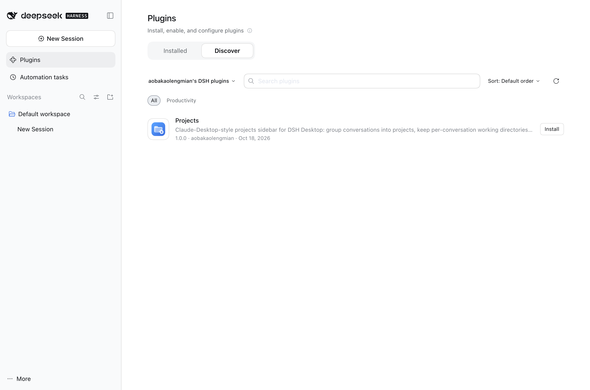

# dsh-projects

Claude-Desktop-style **Projects** for **DSH Desktop** (the `desktop` DSH profile
only — Web and headless profiles are untouched).

The shipped DSH sidebar groups conversations by Workspace (directory). This
plugin replaces that sidebar region with a project-first browser:

- create **projects** (name, color, one or more working directories);
- every conversation lives inside a project;
- **each conversation can use a different directory**, chosen when it is
  created (or switched later through *Change working directory*), backed by the
  Host's real `workingDirectory` service — the same durable, model-visible
  mechanism as the `working_directory` tool;
- sessions outside any project stay visible under **Other conversations**,
  still grouped by Workspace, so nothing is lost;
- **empty conversations are hidden and can be deleted for real**: the Host keeps
  reusable blank Sessions from every "New Session" click (`blank: true`); only
  the empty Session that is currently open is shown. The Host also scans legacy
  Sessions whose catalog row is not marked blank but whose log contains no
  conversation events at all (only tiny header/metadata logs are inspected), so
  old "Badstuff"-style empty chats are hidden too. *View options → Delete empty
  conversations (N)* permanently removes both kinds from disk through a
  validated Host route (never touches a conversation with content; sessions
  still live in the current app run are archived and can be purged after the
  next start);
- **projects keep the workspace hierarchy**: inside a project, conversations
  stay grouped under their workspace (folder + title + count), so moving a
  workspace into a project preserves its identity instead of flattening the
  chats; workspace headers have their own `+` (new conversation directly in
  that directory — assigned to the containing project, or ungrouped under
  *Other conversations*) and `⋯` menu (new conversation, move to another
  project, rename, remove from project, delete workspace);
- pinned sessions, relative times, running/pending/unread status dots,
  archive/unarchive, rename, fork, pin and copy-ID work from the new rows.

## Install (desktop profile)

The plugin ships as a normal DSH bundle. Two supported ways to install it into
the **desktop** profile (`~/.dsh/profiles/desktop`):

```bash
# 1. self-contained release tarball (share this file with another machine)
npm run pack                                  # -> dist/local-dsh-projects-1.0.0.tgz
plugin_manager install_bundle target=/abs/path/dist/local-dsh-projects-1.0.0.tgz
#   or: desktop-cli plugin --profile desktop add "file:/abs/path/dist/local-dsh-projects-1.0.0.tgz"

# 2. source link for development (client.js edits hot-reload)
desktop-cli plugin --profile desktop add link:"$PWD"
```

The tarball contains only runtime files (`index.js`, `client.js`,
`cordis.patch.yml`, `locale/*.json`, `icon.svg`, `package.json`, `README.md`),
plus `SHA-256`/manifest in `dist/`. See [docs/INSTALL.md](docs/INSTALL.md) for
installation, update, activation/verification and rollback details.

## Plugin market (Discover tab)

DSH has no official built-in market; the Discover tab reads index sources the
user adds. This repository publishes a format-1 index with a commit-pinned Git
install target:

```
https://aobakaolengmian.github.io/dsh-projects/market/index.json
```

Add that URL as an index source in **Plugins → Discover** and install
**Projects** from the card; the same index is readable by the `plugin_market`
tool and by any other DSH Desktop user:



The market entry installs a commit-pinned Git source
(`git+https://github.com/aobakaolengmian/dsh-projects.git#<commit>`), so it can
never drift from the reviewed code. See [market/README.md](market/README.md)
for the format and how to regenerate it (`npm run market`). Installing from the
market is equivalent to the tarball install and still needs one app restart for
the Host row.

## Data

Project metadata is Host-owned and durable, independent of session logs:

- `$DSH_HOME/storages/dsh-projects.json` — projects, session→project
  assignments, last recorded working directory per session;
- sessions themselves stay owned by the Session Controller (nothing is
  rewritten into session logs by this plugin).

HTTP routes served from the existing DSH web server (same origin as the GUI):

| Method | Path | Purpose |
| --- | --- | --- |
| GET | `/dsh-projects/state` | complete project state |
| GET | `/dsh-projects/health` | liveness + counts |
| POST | `/dsh-projects/mutate` | `project.create`, `project.update`, `project.delete`, `session.assign` |
| POST | `/dsh-projects/cwd` | change one conversation's working directory |
| POST | `/dsh-projects/purge` | permanently remove validated empty sessions (rejects content) |
| GET | `/dsh-projects/empty-sessions` | list sessions that hold no conversation content |

POST routes require `content-type: application/json` and `x-dsh-projects: 1`
and a 64 KiB body limit.

## Build

```
npm install          # dev-only: esbuild, react, react-dom, playwright
node scripts/build.mjs   # src/client/* -> client.js (committed artifact)
npm run pack             # build + dist/<name>-<version>.tgz + SHA-256 + manifest
node harness/build.mjs   # mock harness bundle
node harness/shoot.mjs   # screenshots -> harness/shots/
npm test                 # host/model tests (node --test)
```

## Design notes

- The browser entry registers into the shipped `sidebar.workspaces` single slot
  at `priority: -1`, shadowing `ui-workspace`'s browser. The shipped entry stays
  registered underneath: if our component crashes, its entry is abdicated and
  the original sidebar comes back.
- The client bundle imports only `react` / `react-dom` / `react/jsx-runtime`
  from the shell's shared module table and uses `ctx` services for everything
  else (`sessions`, `workspaces`, `uiWorkspace`, `locale`, `slots`).
- Styles use `--dsw-*` theme tokens; literals are limited to project accent
  artwork. All classes are prefixed `pj-`.

## Moving workspaces and conversations between projects

Everything can be migrated without deleting or recreating sessions, through the
project metadata only (session logs are never touched):

- **Drag a conversation row** onto any project section → the session is assigned
  to that project (drag it onto *Other conversations* to remove it from its
  project).
- **Drag a workspace group header** (under *Other conversations*) onto any
  project section → the directory moves into that project (removed from any
  other project's directory list, never duplicated) and every conversation in
  that directory is assigned to it. While dragging, every project shows a
  dashed drop outline and the hovered target is highlighted.
- **Menu path** (same result without dragging):
  - workspace group `⋯` → *Move workspace to project* → pick the target;
  - project `⋯` → *Move working directory to another project…* → pick the
    directory → pick the target project (or *Remove from project (back to Other
    conversations)*);
  - conversation `⋯` → *Move to project* → pick the target (or *No project*).

Moving a directory between projects also makes future sessions created in that
directory (including the shipped Cmd+N flow) land in the target project, and the
project keeps the workspace title as a nested folder group.

Workspace headers (both inside projects and under *Other conversations*) expose
their own menu: **Rename workspace…**, **Move workspace to project**, **Remove
from project** and **Delete workspace**. Deleting a workspace removes only its
registration, puts its conversations back under *Other conversations*, and never
deletes a conversation.

## Compatibility with other sidebar plugins

The installed sidebar-touching plugins were audited and the browser keeps their
integration surfaces intact:

| Plugin | Integration surface | Status with Projects |
| --- | --- | --- |
| `dsh-timeline` | DOM-injects its starred-folder section before `[data-slot="sidebar.workspaces"]`; resolves session rows as `div[role="treeitem"][aria-selected]`; injects "Star Chat to Folder" into host menus found as `body > [role="menu"]` | Works: the slot anchor is preserved (its folder section renders above Projects), every row follows the shipped treeitem/title DOM contract, and menus/modals are portaled to `document.body`, so its injected menu item appears and opens its own dialog |
| `dsh-cost-meter` | Registers `sidebar.footer.action` entries and styles its own footer stack | Works unchanged: footer actions are outside the replaced region |
| `dsh-notification`, `dsh-plugin` (hub), `dsh-thoughtdag`, `dsh-dafeiyu`, `dsh-plugin-whale-pet` | No `sidebar.workspaces` DOM or row-slot usage (audited client bundles) | No interaction |
| shipped `ui-workspace` browser | Registers the slot at priority 0; its child row-extension slots (e.g. schedule marks) are only rendered by its own component | Our entry shadows it at priority -1; if our component crashes it abdicates and the shipped browser returns. Child-slot extensions are not rendered while Projects is active (non-crashing degradation) |

Live verification with `dsh-timeline` + `dsh-cost-meter` + Projects mounted in one
real DSH host: our sidebar rendered 57/57 sessions as timeline-compatible
treeitems, timeline's starred-folder section appeared above Projects, timeline's
"Star Chat to Folder" item was injected into our session menu and opened its
dialog, cost-meter's footer card rendered normally, our menus/search stayed
functional, and the browser console reported no errors.

## Known limits (v1)

- The shipped `ui-workspace` browser's child extension slots
  (`sidebar.workspaces.session.menu.item`, `sidebar.session.row.leading`, …) are
  not rendered by our browser, so shipped/third-party row decorations registered
  there (for example the schedule mark) do not appear while it is active. The
  shipped built-in session actions are re-implemented directly in the project
  menus, and `dsh-timeline`'s DOM-based decorations do work (see above).
- Global shortcuts owned by `ui-workspace` (Cmd+N / Cmd+K) keep their shipped
  behavior; our search field is opened through the header icon.
- Collapsed sections, archived filter and the last viewed state are stored in
  the browser's `localStorage`; project data lives Host-side.
- The empty-Session scan and permanent deletion run through the Host half, so a
  client bundle that hot-reloads before the Host half does cannot see them: the
  scan is skipped and the cleanup falls back to archiving blank Sessions, telling
  the user to restart the app once. After that restart the sidebar hides legacy
  empty chats automatically and the same menu entry deletes them from disk.
  Empty Sessions created during the current app run are always archived first
  and purgeable on the next start.
